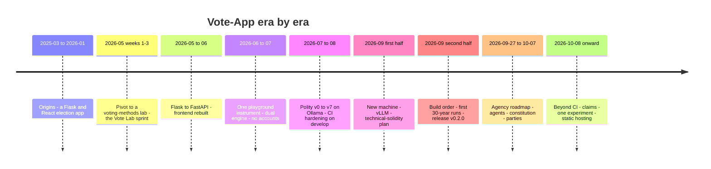

# Vote-App: a history by era

> **status:** reference. Written 2026-10-12 from the journal (`journal/`), the plans, the ADR, EXP
> and OBS records, and the merge log of `polity`. Where this page and a linked document disagree,
> the linked document wins. Asked for by `PLAN_BEYOND_CI.md` decision D7 (reversed 2026-10-12).

Vote-App is today one repository with three parts: **Vote Lab**, a teaching app for voting methods
(29 methods, a five-moment playground, a laboratory of fiches); **Polity**, an offline simulator of
a society of 100 to 500 citizens over 30 years in which a local open-weights LLM plays some of the
citizens; and the **process** that keeps both honest. [`overview/README.md`](overview/README.md)
describes what each part is and why it is built that way; [`STATUS.md`](STATUS.md) says where each
stands. This page says how the project got there. It runs in chronological order, oldest first, one
section per era, and ends with the threads that run through all of them.

A caution on sources: journal entries before 2026-08-19 were reconstructed from `git log` on that
date, and many later ones from PR bodies on 2026-10-12; each says so in its header. Where no source
records why something was done, this page says so instead of guessing.

## 1. Origins: an election app (2025-03-01 → 2026-01-13)

**PRs #2–#24.** Work stopped on 2025-07-04, resumed briefly on 2025-10-29, stopped after 2026-01-13.

**What was built**
- A conventional e-voting application: Flask backend, React frontend, CRUD for elections, candidates
  and voters, user roles (organiser, voter, candidate) and profile pages.
- Three counting methods (simple majority, Condorcet winner, two-round), a first "simulation" of
  voter–candidate interaction, and separate lint and test CI for backend and frontend.

**Decisions and reasons.** None recorded. The commits of this period are short and factual; the
journal's reconstruction states that it can say *what* was built but not *why*. Why work paused
twice is not recorded either.

**Read more:** [`journal/archive/JOURNAL_2025.md`](journal/archive/JOURNAL_2025.md), its two
entries.

## 2. The pivot and the Vote Lab sprint (2026-05-03 → 2026-05-23)

**PRs #25–#35**, but most of this era went in as local merge commits without a PR: 149 of the 154
merges on `polity`'s first-parent history from 05-03 to 05-23 (New York time).

**What was built**
- On 2026-05-03, in one day: a spatial voting model (positions in [0,1] per issue), five strategic
  behaviours, and a comparison engine (Bayesian regret, majority satisfaction, strategic
  vulnerability, Condorcet consistency).
- The election system itself was **deleted** (its `Election`, `Vote` and `Result` tables, routes and
  pages) and replaced by a simulation sandbox.
- 67 unit tests for 19 methods. Writing them found two real bugs: Minimax and Schulze counted
  pairwise opposition in one direction only, so the winner depended on Python's iteration order.
- Over three weeks: from 19 to more than 30 methods, about twenty interactive pages on social-choice
  results (Arrow, Plott, Sen, Gibbard–Satterthwaite, Duverger and others), a move from Create React
  App to Vite, and 35 comparison tabs merged into one "Election Lab".

**Decisions and reasons**
- Remove the election system rather than keep it beside the sandbox: the commit restructures the
  code around the sandbox. *Why the project changed direction at all is not recorded.*
- Build each research topic as its own page: the reason was not recorded; era 4 undid it.

**Read more:** [`journal/archive/JOURNAL_2026.md`](journal/archive/JOURNAL_2026.md), entries
"2026-05-03 — Pivot" and "2026-05-03 → 2026-05-23 — Sprint « Vote Lab »".

## 3. Flask to FastAPI, and the frontend rebuilt (2026-05-23 → 2026-06-09)

**PR #37** is the only PR merged in this window (2026-06-09); the work itself went in as named local
merges (`feat/phase3-batch1` … `feat/phase7-pages-cleanup`), and Flask was removed by
`feat/phase4.5b-retire-flask` on 2026-05-30.

**What was built**
- Phases 0–1: structured logs (structlog); Pydantic schemas that generate TypeScript types.
- Phases 2–4: a FastAPI app mounted beside Flask under `/api/v2/`, then migration endpoint by
  endpoint: 35 election endpoints in nine batches, 52 theory endpoints, scenario CRUD,
  authentication (`fastapi-users`, Google and GitHub OAuth), and Monte-Carlo streaming over
  Socket.IO. Phase 4.5 removed Flask; the backend has been FastAPI only since.
- Phase 5: a typed `openapi-fetch` client with TanStack Query; React Contexts replaced by Zustand
  stores (kept as shims until every consumer moved); axios removed.
- Phase 6: `response_model` on every endpoint, Jest → Vitest, Bootstrap → Tailwind v4 + shadcn/ui,
  file by file. Phase 7: secondary pages cleaned up, `security.txt`.
- Strict mypy end to end (26 modules taken off the exclusion list), blocking flake8 and ESLint.

**Decisions and reasons**
- Migrate in independent, separately verified batches rather than one cutover (the strangler-fig
  pattern `CLAUDE.md` names), so a regression stays small enough to isolate; the same on the
  frontend, where Context shims went only once every consumer had moved.

**Learned or reversed.** The authentication stack migrated here was deleted five weeks later (era 4,
[ADR-007](adr/ADR-007-no-authentication-stateless-anonymous-app.md)).

**Read more:** [`journal/archive/JOURNAL_2026.md`](journal/archive/JOURNAL_2026.md), entry
"2026-05-23 → 2026-06-09".

## 4. One playground, two engines, no accounts (2026-06-10 → 2026-07-30)

**PRs #38–#116** (plus local merges; about 400 commits in seven weeks).

**What was built**
- The Playground (P0–P5, merged 2026-06-12), which absorbed the Election Lab's 40 phenomena in six
  families (#41–#44) until the Election Lab was retired on 2026-06-15.
- The five-moment rail (Électorat → Méthode → Stratégie → Campagne → Bilan) and a separate
  `/laboratoire` for advanced analysis (merged 2026-06-29).
- **The client ⇄ backend parity harness** (#48, 2026-06-27): 14 rules locked identical. It found
  four real backend bugs (Bucklin not cumulative, IRV/Coombs elimination, a wrong Schulze path, a
  STAR tie) and one client defect.
- A public-facing layer: `/decouvrir`, `/campagne`, "À vous de jouer" (an interactive ballot in five
  ballot languages); `THEORY.md` (17 methods).
- Accounts and the community layer removed (2026-07-06); a single-container public deploy on Fly.io
  (2026-07-08) with cookieless self-hosted analytics (Umami).

**Decisions and reasons**
- One instrument, not a gallery of pages
  ([ADR-006](adr/ADR-006-playground-single-five-moment-instrument.md)): the retirement commit cites
  duplicated state and circular drill-downs between two surfaces showing the same data.
- Two voting engines locked by a golden fixture
  ([ADR-004](adr/ADR-004-dual-voting-engine-with-parity-lock.md)): the playground must redraw win
  zones while a candidate is dragged, so it needs a client engine; correctness needs a tested
  reference.
- No accounts, a stateless backend
  ([ADR-007](adr/ADR-007-no-authentication-stateless-anonymous-app.md)). The commits record the
  removal in detail but **not the product reason**; the ADR says so. ADR-004 to ADR-007 were all
  written retroactively from the commits on 2026-09-08 (#318).

**Read more:** [`journal/archive/JOURNAL_2026.md`](journal/archive/JOURNAL_2026.md), entry
"2026-06-10 → 2026-07-30".

## 5. Polity v0 → v7 on Ollama, and CI hardening on `develop` (2026-07-30 → 2026-08-30)

**PRs #117–#231.** Polity was developed in its own worktree (branched from `develop` on 2026-07-30);
`develop` carried the Vote Lab and CI work in parallel.

**What was built (Polity)**
- 2026-07-30: the design document
  ([`plan/polity/polity-simulation-design-v2.md`](plan/polity/polity-simulation-design-v2.md)) and a
  [precision audit](plan/polity/audit-precision-plan.md) that settled the v0 blockers.
- v0 and v1 (#117–#119, 2026-07-31): a purely mechanical skeleton, 100 citizens over 120 ticks, no
  LLM, whose central test is that two same-seed runs write byte-identical journals.
- v2 (#120–#127, #130): a local LLM (`qwen3:8b` on Ollama) takes over the vote, then four more
  decisions, each additive over the deterministic rules.
- v4 (#131–#141): legitimacy, mandate and citizen pressure, built deterministically first so any
  later drift could be attributed to the LLM; then the first two LLM decisions on it; Lot 9 (#141)
  added competitive blank voting. v5 (#142–#146): exogenous shocks. v6a (#147–#150): a social graph
  and contagion. v6b (#151–#153): a sortition chamber. v7 (closed by #227): multi-round coalition
  negotiation.
- Ollama moved to the GPU on 2026-08-17 and four bugs followed
  ([ADR-001](adr/ADR-001-serving-layer-ollama-vs-llama-server.md): stay on Ollama). `polity` got its
  own CI on 2026-08-29 (#226).

**What was built (`develop`)**
- First property-based tests (#155); mutation, dead-code, duplication and complexity tools in
  informative mode (#157, #158), a blocking OpenAPI contract (#159), and releases gated on the e2e
  suite (#160).
- The e2e suite rewritten (#170) after two months of drift, anchored on `data-testid`, run on every
  PR, with routes as data; then a five-part CI hardening plan (#172–#175,
  [`plan/vote-app/cihardeningplanv2.md`](plan/vote-app/cihardeningplanv2.md)).
- Mutation testing taken at its word (#176–#187): the score first measured its own hand-picked test
  selection (14 of 80 test files). In the same series, 13 of 26 backend rules elected a different
  winner when the same ballots were permuted; #183 made them break ties by candidate name, the
  convention the code already used elsewhere (questioned later: eras 7 and 9).

**Decisions and reasons**
- Keep v0/v1 deterministic: they are the baseline against which the LLM's contribution is measured.
  Check batching determinism *before* writing the first LLM module: concurrent identical calls
  diverged, so batching stays static.
- On 100% blank presidential ballots at full scale (v4, 2026-08-14), the owner chose root-cause
  investigation over quick mitigation: a blank vote must mean real disapproval, not model
  uncertainty.
- The shipped candidacy configuration could not hold an election: `ambition_threshold` 0.7 → 0.30
  ([ADR-002](adr/ADR-002-ambition-threshold-blocks-candidacy.md)); the ballot-access filter was
  inert ([ADR-003](adr/ADR-003-ballot-access-filter-is-inert.md)). Citizen positions moved from
  uniform to a factor structure, because uniform positions structurally favoured the blank vote
  ([`plan/polity/plan-distribution-positions-seeds.md`](plan/polity/plan-distribution-positions-seeds.md)).
- The first vLLM attempt (#231, 2026-08-29) hit `UVA is not available` under WSL2/Docker Desktop.
  The owner kept `provider: ollama` and recorded dated conditions for reopening.
- The sortition chamber's veto was deferred: it needs a concept of a law that the model did not have
  (it came back as [ADR-008](adr/ADR-008-law-system-seam-bounds-and-comparability.md) and
  [ADR-009](adr/ADR-009-ordinary-legislation.md)).

**Learned or reversed.** `pressure_action` was found collapsed in isolation on 2026-08-30 (41.7%
disagreement against a pre-registered bar) and marked unreliable at once; the same relational
framing problem appeared in four decision types. Options set aside (native `llama-server`, LocalAI,
larger models) wait in [`BACKLOG-alternatives.md`](adr/BACKLOG-alternatives.md).

**Read more:** [`journal/archive/JOURNAL_2026.md`](journal/archive/JOURNAL_2026.md), entries
2026-07-30 to 2026-08-30.

## 6. A new machine, vLLM, and the technical-solidity plan (2026-08-31 → 2026-09-14)

**PRs #232–#489 and #492**, merged 2026-08-31 to 09-14 (`develop` and `polity` in parallel).

**What was built**
- The machine moved from Windows/WSL2 to native Ubuntu (#232–#236, #252–#254). The reason is not
  recorded (#235 cites a migration plan not in the repo); on 2026-08-29 native Linux had been listed
  among the options *not* taken for vLLM.
- vLLM verified live under native Ubuntu (#273, 2026-09-05): byte-identical outputs for batches of 1
  to 50 concurrent calls, the reverse of Ollama. The shipped provider switched to vLLM inside #350
  (merged 2026-09-10), with a logprob instrument that quantified collapses previously invisible. The
  v3 scale gate was passed at population 500. Python 3.14 followed (#272).
- [`PLAN_SOLIDITE_TECHNIQUE.md`](plan/vote-app/PLAN_SOLIDITE_TECHNIQUE.md), opened 2026-09-07: Lots
  0–13 delivered in six days (203 commits, 86 PRs). Lot 0 separated the documentation surfaces and
  created the EXP records, Lot 1 brought Mergify, Lot 4 checked the voting engine against theory
  (fuzzed axioms, a third-party oracle, exhaustive small cases, Z3). EXP-001 to EXP-015 record the
  verdicts ([`exploration/README.md`](exploration/README.md)).
- Polity: `pressure_action` recalibrated, all nine decision types made to degrade to a deterministic
  fallback instead of four of them killing the run (three fatal crashes in four days), a liveness
  check, and [ADR-008](adr/ADR-008-law-system-seam-bounds-and-comparability.md) as design only
  (2026-09-11).

**Decisions and reasons**
- "Every item is an experiment, not a task": a rejection with a reason counts as a result (#314).
- Compare against an independent oracle to break "both engines wrong together" (#354), and compare
  without filters: the fixture's `strict_winner` filter hid the profiles where four of five bugs
  lived (#355).
- Move to vLLM: recorded only by the commit title; the detail is in
  [`plan/polity/plan-vllm-switch-readiness.md`](plan/polity/plan-vllm-switch-readiness.md). **No ADR
  records it**, and ADR-001 (stay on Ollama) still reads Accepted.

**Learned or reversed.** The plan's own retrospective
([`plan/vote-app/RETROSPECTIVE.md`](plan/vote-app/RETROSPECTIVE.md)) finds the dependency order held
but the rhythm did not: one day (2026-09-11) carried most of Lots 7–13 (one session that day cost
10,936 API requests); the journal then had no entry from 09-06 to 09-11 (since backfilled, mostly on
2026-10-12); Lot 14 (repaying the debt Lot 6 measured) was left open. EXP numbers collided across
branches twice (see the note at the end of the EXP index). The OBS log's first entries date from
2026-09-11 and 2026-09-13 ([OBS-001](plan/polity/observations.md#obs-001) onward).

**Read more:** [`journal/archive/JOURNAL_2026.md`](journal/archive/JOURNAL_2026.md), entries
2026-08-31 to 2026-09-14.

## 7. Build order, the first 30-year runs, release v0.2.0 (2026-09-13 → 2026-09-27)

**PRs #490–#677** except #492, merged 2026-09-15 to 09-27.

**What was built**
- [`plan/polity/plan-polity-build-order.md`](plan/polity/plan-polity-build-order.md) (2026-09-13),
  the executable form of a research synthesis: Stages 0–5, each step with an acceptance criterion
  written before it runs. S0.1–S0.4 went in as local merges that day; Stage 4 on the LLM path
  followed (#536–#572, pre-registered in #537).
- The `/polity` run explorer (#489–#514), with Canvas 2D for dense point clouds
  ([ADR-013](adr/ADR-013-canvas-2d-for-dense-point-clouds.md)).
- An outward-facing audit by six of the project's own agents (#515,
  [`PLAN_SURFACE_EXTERIEURE.md`](plan/vote-app/PLAN_SURFACE_EXTERIEURE.md)): what is weak sits at
  the boundary with the outside world (deployment, users, abuse, pedagogy). First fixes: #518–#527,
  among them bounds on 23 unvalidated request fields.
- A separate, repo-wide over-engineering audit (`ponytail-audit`) led to a cleanup (#553–#603) that
  also found real bugs: `/collective-will` invented the winner of four methods in ten (#591), three
  endpoints answered with plurality for an unknown rule name (#592).
- The listing-order tie series (#604–#661): candidate order must never change a result. The causes
  differed. Count ties already had a sealed seeded lot, extended to new sites (#643, #659);
  utilities rounded to four decimals invented preference ties that did not exist, removed at the
  root (#657); Kemeny depended on the interpreter's hash seed (#604); the strategic transform
  invented a first-place tie (#661). The rest became issues #662–#667
  ([`plan/vote-app/LISTING_ORDER_TIES.md`](plan/vote-app/LISTING_ORDER_TIES.md),
  [EXP-022](exploration/EXP-022-listing-order-ties-lot-vs-name-vs-rounding.md)).
- vLLM 0.29 without n-gram speculation (#629,
  [EXP-018](exploration/EXP-018-vllm-ngram-speculation-real-traffic.md)), 0.30 (#631), then EAGLE-3
  (#647, #656, [EXP-019](exploration/EXP-019-eagle3-speculative-decoding.md)).
- **The first full run** (2026-09-26): 30 years, 500 citizens, 75 seats, seed 42, 2 h 08, replayed
  byte for byte from its call log in 86 s
  ([EXP-020](exploration/EXP-020-replay-calls-vs-seed-determinism-full-run.md), #658,
  [`plan/polity/plan-full-run.md`](plan/polity/plan-full-run.md)); replicated on seeds 1 and 2
  (#670). Stories in [`runs/`](runs/README.md).
- **Release v0.2.0**, the repository's first tag (2026-09-27): `develop → main` (#669, 470 PRs), a
  failed first dispatch of `release.yml`, then #672 and #673.

**Decisions and reasons**
- Drop n-gram speculation (owner, 2026-09-20, #629): no wall-clock gain on real 12-worker traffic,
  the production mode. The accepted cost was the same-seed guarantee: with speculation, 0.28.0 and
  0.29.0 runs were byte-identical; without it, two of three pairs differed (suspected cause Model
  Runner V2, [OBS-020](plan/polity/observations.md#obs-020), open), and the byte-identity test
  became `xfail`, replaced by a test that replay from the call log is exact.
- Adopt EAGLE-3 (#656): the owner "does not rely on same-seed byte-identity as long as a run leaves
  enough logs to be read closely". Do not adopt NVFP4 (#630): 1.8× slower, and it did not lift the
  collapses.
- A name tie-break for utility rankings was coded and shelved (EXP-022): it trades a dependence on
  order for one on names, and would break client–backend parity unless both engines changed.
- After the release, `develop` and `polity` converged (#671, #674, #675) and **`polity` became the
  working branch** (#676), at the owner's decision.

**Learned.** The full run confirmed structural defects at scale: one invalid unit sends its whole
batch to the fallback ([OBS-021](plan/polity/observations.md#obs-021)); the thinking budget binds on
86% of `vote_cast` calls ([OBS-023](plan/polity/observations.md#obs-023)).

**Read more:** [`journal/JOURNAL_DE_BORD.md`](journal/JOURNAL_DE_BORD.md), entries 2026-09-16 to
2026-09-27.

## 8. The agency roadmap: agents, a constitution, parties (2026-09-27 → 2026-10-07)

**PRs #678–#849**, except #845 (merged 2026-10-10).

**What was built**
- [`plan/polity/plan-polity-agency-roadmap.md`](plan/polity/plan-polity-agency-roadmap.md) (#678),
  with decisions D1–D10 taken with the owner on 2026-09-27: agents act, the kernel referees.
- Phase 0: each LLM answer validated inside the retry loop (#679). Phase 1: approval feeds
  legitimacy, with the exploration profile (#680, step 1.1; row 0.2 was folded into it); the
  president becomes an agent with a persona and a memory rebuilt from the journal (#689,
  [ADR-014](adr/ADR-014-agent-tier.md)). Phase 2: a typed, amendable constitution (#699–#701,
  [ADR-015](adr/ADR-015-typed-constitution.md)). Phase 3: a forum, and opinion change (#702–#704,
  [ADR-016](adr/ADR-016-forum.md), [ADR-017](adr/ADR-017-opinion-change.md)). Phase 4: mutable
  parties, leader coalitions, a referendum, disengagement (#705–#708, ADR-018 to ADR-021).
- Phase 5: `refuse_to_leave` (#711, [ADR-022](adr/ADR-022-extra-legal-acts.md)) and targeted
  campaigning (#734, [ADR-023](adr/ADR-023-campaigning.md)).
- A ten-seed ensemble (`phase10`), vLLM 0.31.0 (#789), and the explorer reviewed against ten of the
  141 real runs on the machine (#759–#783).
- Process: `CLAUDE.md` rules became checks: agent guardrail hooks (#731), a high-risk review gate
  (#724, #732, #847), test integrity (#736), a CI dashboard (#763), `/verify` (#788).

**Decisions and reasons**
- New mechanisms ship **off** by default and **on** in the exploration profile, gated by sanity
  checks and OBS entries; pre-registration is kept for claims stated as results (roadmap D4).
- Build the acts agents actually try first: the limit-testing log asked for a way to reach voters,
  not for extra-legal acts ([OBS-035](plan/polity/observations.md#obs-035)), so campaigning moved
  ahead of the rest of Phase 5. The roadmap records no further reason for D1–D10 beyond their text.
- Lock the presidential term limit at 75% (#784, owner's choice) after the chamber ratified a third
  term whose ballots echoed the proposer's reason ([OBS-038](plan/polity/observations.md#obs-038)).
- `/code-review high` before every PR (owner, 2026-10-07, #835); no reason recorded.

**Learned or reversed**
- Agents founded no party at all until the prompts were measured against paraphrases
  ([OBS-029](plan/polity/observations.md#obs-029), #710, #714). Party founding events had never been
  registered ([OBS-039](plan/polity/observations.md#obs-039), #781), so two earlier observations
  were measured with party-blind agent memory.
- The Phase 4 exit was declared met on three seeds (#729,
  [OBS-034](plan/polity/observations.md#obs-034)) and found **not met** on ten
  ([OBS-040](plan/polity/observations.md#obs-040), #800). The same ensemble exposed a misdated term
  end ([OBS-041](plan/polity/observations.md#obs-041), #801) and an abstention rule that grew with
  the field ([OBS-042](plan/polity/observations.md#obs-042), #819, ADR-011 amended).
- The first high-risk review gate held nothing: a PR passed the merge queue in 16 seconds without
  review (#731), and #732 replaced it with a required status.

**Read more:** [`journal/JOURNAL_DE_BORD.md`](journal/JOURNAL_DE_BORD.md), "2026-09-28" to
"2026-10-07" entries.

## 9. Beyond CI: claims, one experiment, static hosting (2026-10-08 → now)

**PRs #850–#933**, plus #845.

**What was built**
- [`PLAN_BEYOND_CI.md`](plan/PLAN_BEYOND_CI.md) and [`STATUS.md`](STATUS.md) (#858). Its premise:
  the project checked code against code, but nothing checked what it *claimed*; and 61% of October's
  changed lines so far had been CI and process.
- **W1, claims.** A paradox story that named a Condorcet winner in a cycle, nine criteria cells and
  `THEORY.md` fixed (#859, #868); one criteria registry checked by both engines (#869); a "report a
  content error" form on stories and Lab fiches (#875), then on every matrix cell a tooltip with the
  verdict's basis and source, and a report link (#899); a review packet for one social-choice
  researcher (#900, [`research/expert-review-packet.md`](research/expert-review-packet.md)).
- **W2, Polity.** Founders told the seat threshold (#861, D2), paired statistics and re-seating
  tools (#862–#865), a fit-for-inference table (#866,
  [`plan/polity/fit-for-inference.md`](plan/polity/fit-for-inference.md)). **The threshold
  experiment stopped at its gate** (#877, [OBS-045](plan/polity/observations.md#obs-045)): founders
  founded 59 times in 60 at 3% and at 7%. The time went to a write-up on the logprob instrument
  (#879,
  [`stories/the-answer-that-did-not-depend-on-the-question.md`](stories/the-answer-that-did-not-depend-on-the-question.md))
  and a preprint draft (#913, [`preprint/`](preprint/README.md)); nothing is submitted.
- Polity kept building in parallel: the Phase 4 exit restated (D11, #892), a half-term rule (#891),
  disengaged citizens kept from voting ([OBS-046](plan/polity/observations.md#obs-046), #904),
  strategic voting ([ADR-024](adr/ADR-024-strategic-voting.md), #905), majority recall after
  [OBS-047](plan/polity/observations.md#obs-047) ([ADR-025](adr/ADR-025-majority-recall.md), #915),
  and presidents who see what a rule change would do (ADR-026 to ADR-028, #918, #923).
- **W3, playground:** a winner strip on every moment (#874), the Bilan says why each winner wins
  (#885), screen-reader announcements and 44 px touch targets (#903, #906).
- **W5, ties:** a seeded lot, the same on both engines (#880, #887, #890, #894, #895, #927); what
  remains is issue #926.
- **W6, hosting:** a spike measured the backend's own routers running in the browser under Pyodide
  ([EXP-023](exploration/EXP-023-pyodide-web-worker-vs-fly-container.md), #908); the owner chose
  static hosting on 2026-10-11, built in five PRs (#914, #916, #917, #921, #924). It goes live with
  the first release after two workflow edits only the owner can push.
- The project overview (#929), the journal reopened and backfilled (#930, #933), the stories of the
  three 30-year runs (#932, [`runs/`](runs/README.md)), and this history.

**Decisions and reasons**
- Freeze CI and process work to maintenance while the plan runs (the context is the 61% above).
- Stop without a pilot, a main run or a pre-registration when the gate says so (#877): the plan's
  own rule, "If founding does not respond, stop. That is the finding, and it is cheap."
- D11 (#892): report the effective number of parties instead of gating on it; no lever had moved
  fragmentation ([OBS-044](plan/polity/observations.md#obs-044), OBS-045), and in the literature the
  1.5–8 band owes much to strategic voting, which the model did not have.
- Ties drawn by a seeded lot on both engines (owner, 2026-10-09,
  [`LISTING_ORDER_TIES.md`](plan/vote-app/LISTING_ORDER_TIES.md)): a name tie-break was rejected,
  since it swaps order-dependence for name-dependence. The score rules and voters' own ties moved
  (#887, #890, #894); the backend's ranked rules still break ties by name until #926.
- 110 unsourced criteria cells left as `null` under a ceiling that can only fall, rather than
  unverified citations (#869).

**Learned or reversed**
- D7 retired the journal on 2026-10-08 (#858, #867): 124 PRs had merged since its last entry. The
  owner reversed it on 2026-10-12 (#930); the gaps were backfilled from git and PR bodies.
- None of ADR-024 to ADR-028 has been measured on a full LLM run; each PR defers that to the next
  ensemble. Why founding ignores the stated threshold (OBS-045) is still open.

**Read more:** [`journal/JOURNAL_DE_BORD.md`](journal/JOURNAL_DE_BORD.md), the five newest entries
(2026-10-08 on).

## Threads that run through it

**Two engines kept honest** (eras 2, 4, 5, 6, 7, 9). The voting rules have been wrong in ways only a
second implementation or an outside oracle could show: Minimax and Schulze on the first day of tests
(era 2); four backend bugs and one client defect when the parity harness arrived (#48); 13 backend
rules whose winner changed when ballots were permuted (#183), which the parity harness had silently
skipped; four of five bugs hidden by a fixture filter (#355); candidate listing order deciding
results (#604–#661, #887). Ties show the cost: a name tie-break adopted (#183), questioned when a
second one was shelved (EXP-022), rejected for a seeded lot (2026-10-09) that now covers the score
rules and voters' own ties, with the backend's ranked rules still to move (#926). Each fix became a
test both engines run ([ADR-004](adr/ADR-004-dual-voting-engine-with-parity-lock.md), the criteria
registry #869). Approval is still locked only at the tally (`CLAUDE.md`).

**Measure before believing the LLM** (eras 5–9). Valid JSON was never evidence of a sound decision;
the record shows a degenerate batch (v4's blank ballots), a decision type collapsed whatever its
input (`pressure_action`, `coalition_decision`, [OBS-007](plan/polity/observations.md#obs-007)), a
prompt that steered agents ([OBS-029](plan/polity/observations.md#obs-029),
[OBS-031](plan/polity/observations.md#obs-031)), an agent memory blind to events
([OBS-039](plan/polity/observations.md#obs-039)), and an experiment stopped because the model
ignored the variable ([OBS-045](plan/polity/observations.md#obs-045)). Tools that came out of it:
the logprob instrument (#350), the prompt-neutrality harness (#714), the fit-for-inference table
(#866), the OBS log itself.

**Reproducibility, first required, then traded for a record** (eras 5, 6, 7, 8). v0's central test
was byte-identical same-seed journals; Ollama's batching broke that
([ADR-001](adr/ADR-001-serving-layer-ollama-vs-llama-server.md)); vLLM restored it (#273) until the
owner dropped n-gram speculation on 2026-09-20 (#629,
[OBS-020](plan/polity/observations.md#obs-020)), and the guarantee went with it. Replay from a call
log replaced regeneration
([EXP-020](exploration/EXP-020-replay-calls-vs-seed-determinism-full-run.md)), and the agency
roadmap states that non-determinism is wanted.

**Process that had to be taken back** (eras 3, 4, 5, 8, 9). Several structures were built, found
wrong, and undone: an authentication stack migrated then deleted; an Election Lab grown then
retired; an e2e suite run only at release, which drifted for two months (#170); required checks that
never ran (#257); a review gate that held nothing (#724 → #732); an October in which 61% of changed
lines were CI and process, answered by a freeze (`PLAN_BEYOND_CI.md`). Rejected tools and set-aside
options are kept with their reasons ([EXP index](exploration/README.md),
[`BACKLOG-alternatives.md`](adr/BACKLOG-alternatives.md)).

**Documentation that drifted, and how it is kept now** (eras 4–9). Much of the record was
reconstructed after the fact: the journal on 2026-08-19 and again on 2026-10-12, ADR-004 to ADR-007
on 2026-09-08. Drift was found repeatedly: `SECURITY.md` still describing JWT logins (#313), six
plans showing a false status on 2026-09-11, no journal entry during the busiest week of the solidity
plan until the 2026-10-12 backfill, EXP numbers colliding across branches. What keeps it now:
separate surfaces with their own rhythm ([`README.md`](README.md)), a status line on every plan
(#870, index under [Plans](README.md#plans)), a one-page [`STATUS.md`](STATUS.md), the overview's
rule that the linked document wins and the code wins over both, and this page.
