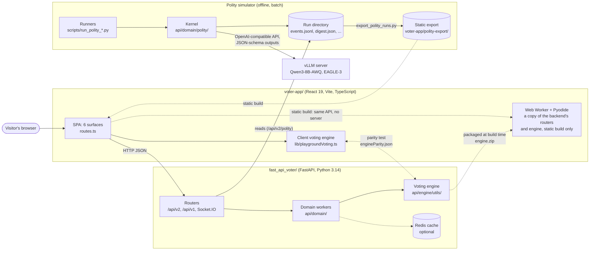
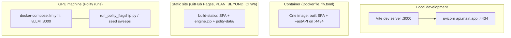

# Vote-App: project overview

> **status:** reference, the entry point for anyone new to the project (researchers included).
> Written 2026-10-12 against `polity` at `ce0e674`. It maps the project and points to the documents
> that own each fact; where this page and a linked document disagree, the linked one wins, and
> where a document and the code disagree, the code wins.

Vote-App is one repository with three parts:

| Part | What it is | Start with |
|---|---|---|
| **Vote Lab** | A teaching and exploration app for voting methods: 29 methods, a live spatial "playground", a laboratory of 63 fiches, 14 guided stories. Anonymous, stateless (ADR-007). | [`vote-app.md`](vote-app.md) |
| **Polity** | A research simulator: a society of 100 to 500 citizens over 30 simulated years, with elections, parties, a constitution, legislation, recalls and a forum. A local open-weights LLM plays some of the citizens. | [`polity.md`](polity.md) |
| **Process** | How the code is kept correct: a dual voting engine locked by a parity test, property-based axiom tests, CI ratchets, recorded experiments (EXP), observations (OBS) and decisions (ADR). | [Process and evidence](#process-and-evidence) below |

The vocabulary for all three is in [`glossary.md`](glossary.md). Where each part stands today and
what comes next is in [`../STATUS.md`](../STATUS.md). How it got here, era by era, is in
[`../HISTORY.md`](../HISTORY.md).

## System context

Three things to read off this picture:

1. **The voting rules exist twice**, in TypeScript (instant feedback while dragging candidates) and
   in Python (authoritative, tested). A generated fixture locks them to the same winners on 28
   methods ([ADR-004](../adr/ADR-004-dual-voting-engine-with-parity-lock.md)).
2. **Polity is offline.** A run takes hours on a GPU and writes files; the app only reads those
   files afterwards (the `/polity` explorer). No visitor request ever reaches the LLM.
3. **The static build has no server.** The backend's own routers run in the visitor's browser
   through Pyodide ([EXP-023](../exploration/EXP-023-pyodide-web-worker-vs-fly-container.md)),
   and the Polity explorer reads a committed export of three runs.

## Where it runs

- **Local:** `fast_api_voter/` serves the API on `:4434`; `voter-app/` serves the SPA. See the
  root [`README.md`](../../README.md) and [`CONTRIBUTING.md`](../../CONTRIBUTING.md).
- **Container:** the root `Dockerfile` builds both into one image (`fly.toml` describes the Fly
  deployment that was the server-hosting option).
- **Static site:** `npm run build:static` (`VITE_ENGINE=browser`). Built, and live from the first
  release that carries its workflow edits ([`STATUS.md`](../STATUS.md)).
- **GPU:** vLLM `v0.31.0` serving `Qwen/Qwen3-8B-AWQ` with EAGLE-3 speculative decoding
  (`fast_api_voter/docker-compose.llm.yml`; variants `docker-compose.llm-*.yml`).

## Reading paths

**A social-choice researcher** (are the voting methods and their claims right?)
1. [`vote-app.md`](vote-app.md): the methods, the metrics and how they are computed.
2. [`../research/expert-review-packet.md`](../research/expert-review-packet.md): the 232
   method × criterion verdicts, what each rests on, and the 110 still without a source.
3. [`THEORY.md`](../../THEORY.md) §2–4 (French): methods, impossibility theorems, paradoxes.
4. [`../research/traceability.md`](../research/traceability.md): method → code → THEORY section →
   bibliography key.

**An LLM-agents or computational social science researcher** (is the simulation sound?)
1. [`polity.md`](polity.md): the model, a tick, the LLM path, the research method.
2. [`../plan/polity/polity-llm-reference.md`](../plan/polity/polity-llm-reference.md): what the
   simulator does today, and §9 "What is actually trustworthy".
3. [`../plan/polity/observations.md`](../plan/polity/observations.md): every strange behaviour
   seen, with its status (OBS-001…047).
4. [`../runs/`](../runs/): the stories of the three 30-year runs.
5. [`../preprint/`](../preprint/): the draft on the logprob instrument.

**An engineer** (how is it built and kept correct?)
1. [`vote-app.md`](vote-app.md) and [`polity.md`](polity.md), the architecture sections.
2. [`CLAUDE.md`](../../CLAUDE.md) and [`CONTRIBUTING.md`](../../CONTRIBUTING.md): gates, workflow,
   the dual engine.
3. [`../adr/README.md`](../adr/README.md) and
   [`../exploration/README.md`](../exploration/README.md): every decision and every tool tried.

## Why it is built this way

Each row names a structural choice, the document that justifies it, and the evidence that it holds.
A choice with no written justification says so: that is a question for review, not an answer.

### Vote Lab

| Choice | Justification | Evidence it holds |
|---|---|---|
| Two voting engines, client and backend | [ADR-004](../adr/ADR-004-dual-voting-engine-with-parity-lock.md): instant feedback needs the client; correctness needs a tested reference | `playgroundVoting.parity.test.ts` against the generated `engineParity.json`, 28 methods |
| Criteria verdicts in one registry, checked by both engines | [`PLAN_BEYOND_CI.md`](../plan/PLAN_BEYOND_CI.md) W1, decision D9 | fast-check (`playgroundVoting.axioms.test.ts`) reads the registry; `test_method_criteria_registry.py` checks it against the Hypothesis matrix (`test_voting_criteria_matrix.py`) |
| Ties drawn by a seeded lot, never by listing order | [`LISTING_ORDER_TIES.md`](../plan/vote-app/LISTING_ORDER_TIES.md), [EXP-022](../exploration/EXP-022-listing-order-ties-lot-vs-name-vs-rounding.md) | `tie_lot.py` and `tieLot.ts`, same lot on both engines (parity) |
| One 5-moment Playground instead of a gallery of pages | [ADR-006](../adr/ADR-006-playground-single-five-moment-instrument.md) | Retired routes redirect (`routes.ts`, `LEGACY_REDIRECTS`) |
| No accounts, stateless | [ADR-007](../adr/ADR-007-no-authentication-stateless-anonymous-app.md) | No database; the only store is an optional result cache |
| Native SVG for core views, Recharts only on demand, Canvas 2D for dense clouds | [ADR-005](../adr/ADR-005-svg-native-core-recharts-for-exploration-only.md), [ADR-013](../adr/ADR-013-canvas-2d-for-dense-point-clouds.md) | Bundle budget (`size-limit`, [EXP-005](../exploration/EXP-005-form-lock-profiler-invariant-and-bundle-budget.md)) |
| Routes → domain → engine layering | [`voter-api` skill](../../.claude/skills/voter-api/SKILL.md) | import-linter contract in `fast_api_voter/pyproject.toml` |
| CPU-heavy work bounded by a semaphore and a timeout | `api/core/worker_dispatch.py` docstring (Lot 3); [EXP-007](../exploration/EXP-007-locust-v2-thread-pool-ceiling.md) measured the ceiling | Requests time out with a 503 instead of starving the pool |
| Static hosting with the engine in the browser | [EXP-023](../exploration/EXP-023-pyodide-web-worker-vs-fly-container.md), decided 2026-10-11 | A CI check that every route answers in Pyodide as on the server (#917) |
| Spatial model (utility = −distance + valence) as the default electorate | THEORY.md §1.2 (the spatial model) | **No ADR.** Other profile generators exist (`profile_engine.py`); why spatial is the default is not written down |
| Approval ballots derived differently on each engine (client ≥ 0.5; backend above the voter's mean) | [`CLAUDE.md`](../../CLAUDE.md), dual engine section | Parity is locked **at the tally only**; the derivations still disagree. **Open question** |

### Polity

| Choice | Justification | Evidence it holds |
|---|---|---|
| A deterministic kernel; the model only proposes typed decisions | [`polity-llm-reference.md`](../plan/polity/polity-llm-reference.md) §4.3; [ADR-014](../adr/ADR-014-agent-tier.md) | Pydantic schemas + `validate_*`; the model never mutates state |
| A complete rule-based twin of every LLM decision | `polity-llm-reference.md` §3 (the §11.4 comparison arm) | `simple_rules.py`; deterministic twin runs (`scripts/twin_runs.py`) |
| Utility vote, with the LLM voting for a 10% audit sample | [ADR-011](../adr/ADR-011-utility-vote-with-turnout.md); build-order decision D2 | The sample's `vote_cast` events carry `audit: 1` and are never counted. **Their agreement with the utility ballot is listed in ADR-011 as a live-run measurement but no figure is recorded yet: open question** |
| A crowd (batch decisions) plus a small first-person agent tier | [ADR-014](../adr/ADR-014-agent-tier.md); agency roadmap D3 | `agents.py`: each turn is decoded, validated (`validate_turn`) and journaled; memory is rebuilt from `events.jsonl` on resume |
| Open-weights model, served by vLLM (D5 plans rented GPUs; the full runs used a local 16 GB RTX 5070 Ti) | Agency roadmap D5; [`plan-vllm-switch-readiness.md`](../plan/polity/plan-vllm-switch-readiness.md). **No ADR records the move to vLLM**: ADR-001 (stay on Ollama) still reads Accepted. Why Qwen3 rather than the probed Gemma or Granite is not written down either | Pinned image, `model_profiles.py`, provenance in each run |
| EAGLE-3 speculative decoding | [EXP-019](../exploration/EXP-019-eagle3-speculative-decoding.md) (n-gram rejected: [EXP-018](../exploration/EXP-018-vllm-ngram-speculation-real-traffic.md)) | About a third less wall-clock |
| Replay from a call log rather than same-seed regeneration | [EXP-020](../exploration/EXP-020-replay-calls-vs-seed-determinism-full-run.md); build-order D1 | `--replay-calls-from` reproduces a run byte for byte; same-seed live runs do not always ([OBS-020](../plan/polity/observations.md#obs-020)) |
| `ambition_threshold` 0.30 | [ADR-002](../adr/ADR-002-ambition-threshold-blocks-candidacy.md): at 0.7 no election could be held | Calibration in [`plan-calibration-ambition.md`](../plan/polity/plan-calibration-ambition.md) |
| Factor-structured citizen positions, not uniform | `polity-llm-reference.md` §2.1: uniform positions let Blank win on 68% of seeds | Measured, 0% with the factor structure |
| A typed constitution (10 amendable articles) | [ADR-015](../adr/ADR-015-typed-constitution.md) | `constitution.py`; rules in force rebuilt each tick |
| Phase order within a tick | `TICK_PHASES` docstring, `run_polity_simulation.py` | Generated table, [`polity-llm-reference.md` §2.3](../plan/polity/polity-llm-reference.md#23-the-per-tick-sequence) |
| A recall needs a majority | [ADR-025](../adr/ADR-025-majority-recall.md), after [OBS-047](../plan/polity/observations.md#obs-047) | Exploration profile |
| Effective number of parties reported, not gated | Agency roadmap D11 (2026-10-10) | phase11 ensemble, [OBS-044](../plan/polity/observations.md#obs-044) |
| Population 500 (not 1000), 30 years | Agency roadmap D3; [`v3-readiness-checklist.md`](../adr/v3-readiness-checklist.md) is the gate before 1000 | Full runs, [`plan-full-run.md`](../plan/polity/plan-full-run.md) |
| Agent prompts in English, crowd prompts in French | Agency roadmap D9 (agents) | **The crowd prompts' language has no written rationale** beyond history; whether it changes behaviour is untested |

## Open questions and known weaknesses

These are where outside review would help most. Each links to where it is tracked.

- **110 criteria verdicts with no source** (`L?` in the
  [review packet](../research/expert-review-packet.md)), and four "variant" cells where the
  engine's version of a method departs from the textbook (decision D8 of
  [`PLAN_BEYOND_CI.md`](../plan/PLAN_BEYOND_CI.md)).
- **"Yes" verdicts from property tests are evidence, not proofs.** Z3 proved a few
  ([EXP-002](../exploration/EXP-002-z3-formal-voting-proofs.md)); the rest rest on random profiles
  with 3 to 6 candidates.
- **Open observations** in Polity ([`observations.md`](../plan/polity/observations.md)), among them:
  - about 40% of citizens declare candidacy at every election (OBS-011);
  - party nominations lean to the last-listed candidate (OBS-013);
  - the thinking budget binds on 86% of `vote_cast` calls at population 500 (OBS-023);
  - no agent ever reaches for an extra-legal act (OBS-035);
  - founders found parties at the same rate whatever the threshold (OBS-045), which stopped the
    threshold experiment at its gate.
- **Fragmentation:** with OBS-041–043 fixed, only 4 of 10 seeds end in the 1.5–8 band of effective
  parties (OBS-044); decision D11 reports the band rather than gating on it.
- **LLM-specific threats:** one model family at 8B parameters, quantised; same-seed runs are not
  always byte-identical without replay (OBS-020); how far results depend on prompt wording is
  probed decision by decision (`scripts/*_results.md`), not across a whole run.
- **The audit sample's agreement** with the utility ballot (ADR-011) has never been reported, so
  how far the model's own vote departs from the kernel's is not measured.
- **The three full runs predate the agency mechanisms** (ADR-014 onward) and the fixes from OBS-028
  on; the ensembles after them (phase10–14) are 5 to 10 seeds at population 100.
- **What the simulator does not model** is listed in `polity-llm-reference.md` §10 "Known gaps".

## Process and evidence

| Record | What it holds | Index |
|---|---|---|
| ADR | Binding decisions, with the rejected alternatives | [`../adr/README.md`](../adr/README.md) |
| EXP | One file per tool or method tried, with its verdict and real cost | [`../exploration/README.md`](../exploration/README.md) |
| OBS | Every strange simulation behaviour, numbered, with its status | [`../plan/polity/observations.md`](../plan/polity/observations.md) |
| Plans | Each plan's first lines give its status (live, reference, done, superseded) | [`../README.md`](../README.md#plans) |
| History | The project told era by era, with the decisions and reversals of each | [`../HISTORY.md`](../HISTORY.md) |
| Journal | The narrative of each work session, from 2025 (archive) on; retired 2026-10-08 and reopened 2026-10-12 (PLAN_BEYOND_CI D7), with its gaps being backfilled | [`../journal/JOURNAL_DE_BORD.md`](../journal/JOURNAL_DE_BORD.md) |
| Run stories | What a simulated society went through, claim-checked against its journal | [`../runs/`](../runs/) |
| Behaviour catalogue | Each Polity invariant, with the test that locks it | [`../spec/behaviors.md`](../spec/behaviors.md) |

The CI gates (types, tests, lint, parity, e2e on four browsers, coverage and quality ratchets,
mutation testing) are described in [`CONTRIBUTING.md`](../../CONTRIBUTING.md) and the
[`voter-ci` skill](../../.claude/skills/voter-ci/SKILL.md).
