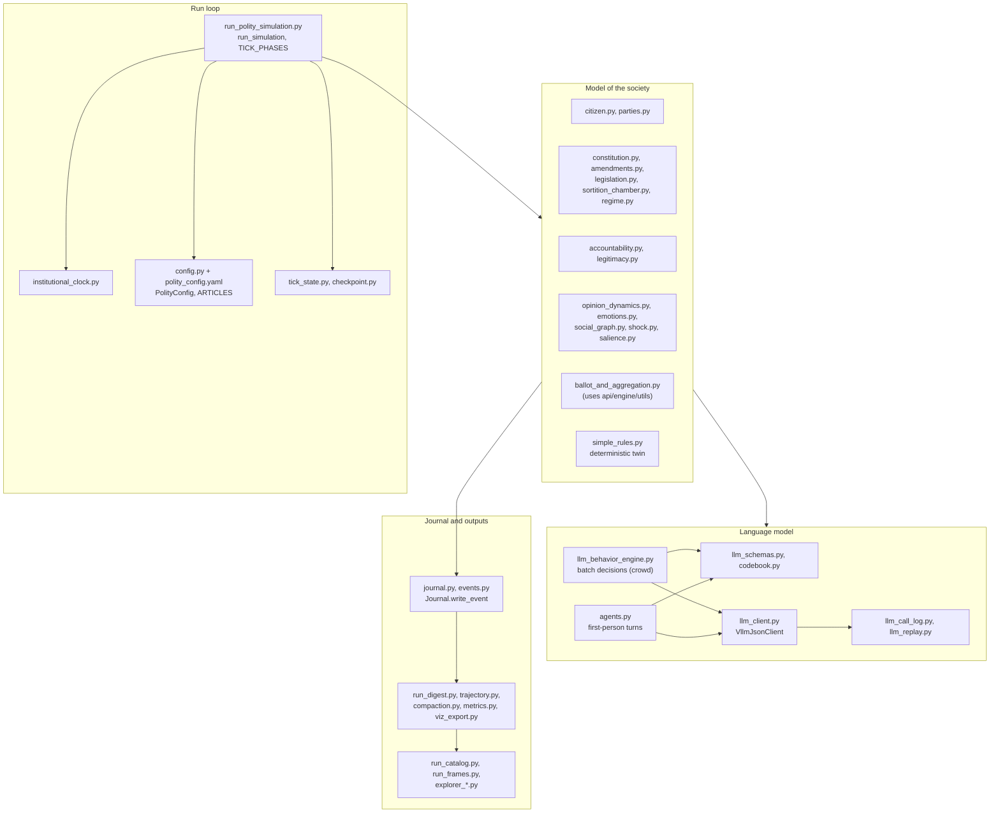
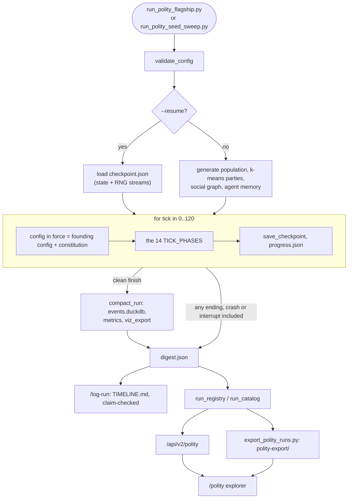
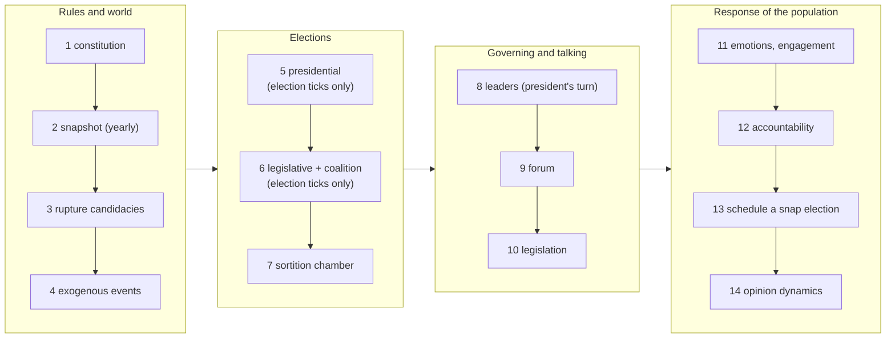
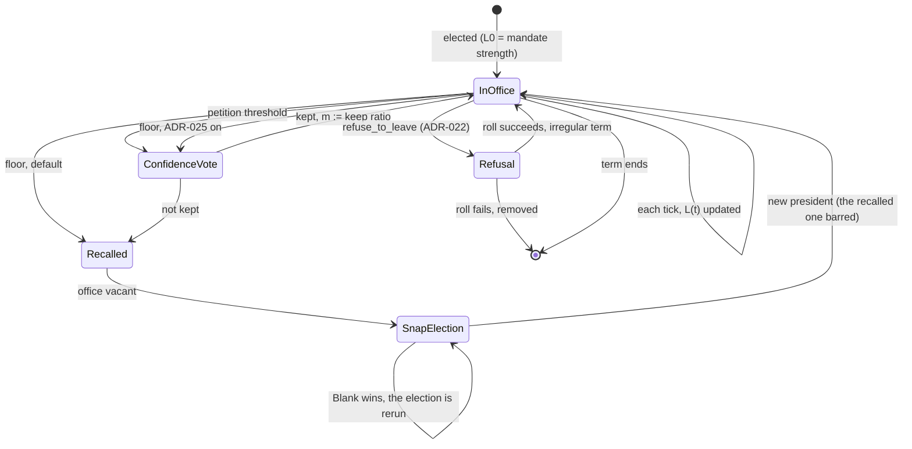
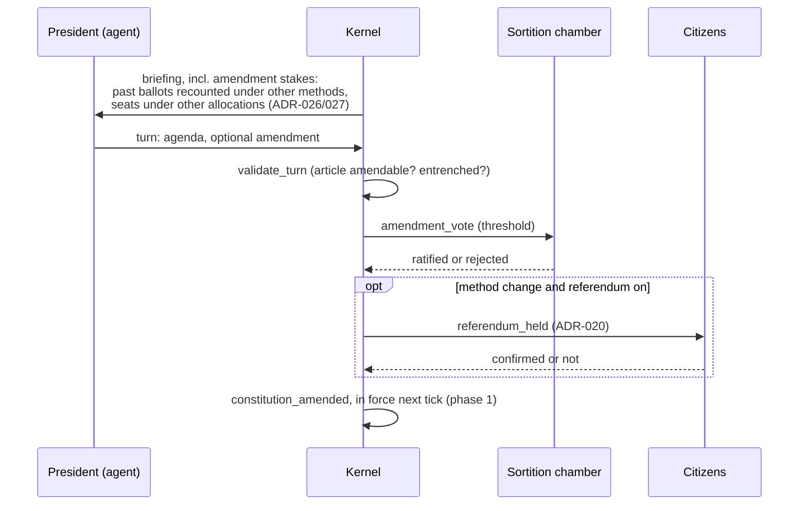
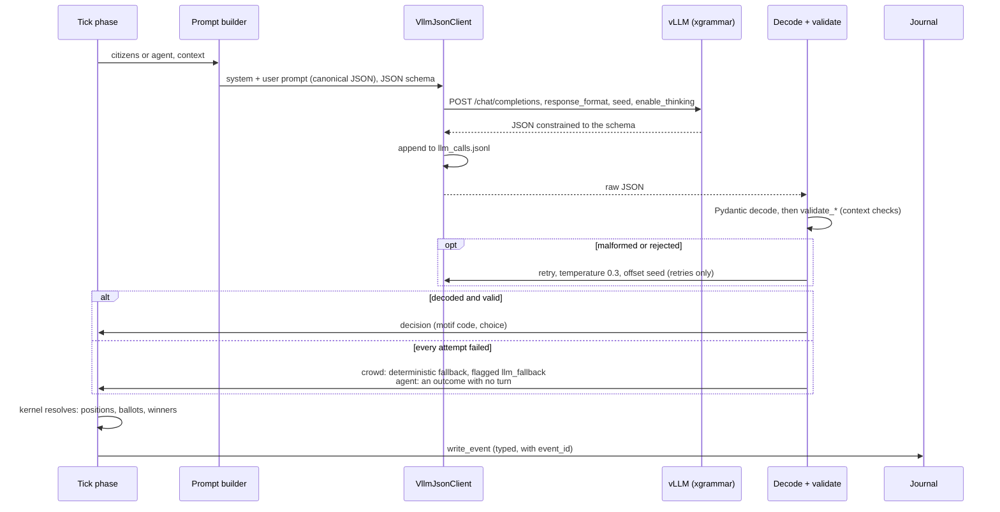

# Polity: architecture and functions

> **status:** reference. Part of the [project overview](README.md); terms are defined in the
> [glossary](glossary.md#polity-model). Verified against `polity` at `ce0e674` (2026-10-12). The
> detailed account of what the simulator does is
> [`polity-llm-reference.md`](../plan/polity/polity-llm-reference.md); the design intent is
> [`polity-simulation-design-v2.md`](../plan/polity/polity-simulation-design-v2.md) (French).

Polity simulates a society over 30 years: a population of citizens with views on 20 issues,
parties, a president and an assembly elected on a calendar, a randomly drawn chamber, legislation,
a constitution that can be amended, recalls, petitions, street pressure and a forum. A local
open-weights LLM takes some of the decisions; a deterministic kernel takes the rest and applies
all of them.

**Where it is going.** The current era's plan, the agency roadmap
([`plan-polity-agency-roadmap.md`](../plan/polity/plan-polity-agency-roadmap.md), set 2026-09-27),
is titled *from classified citizens to a polity that rewrites itself*: from a model that classifies
batches of citizens into closed codes, to citizens and leaders who act in the first person inside
institutions they can change. Its phases (leaders, constitution, public sphere, parties, extra-legal
acts) are what §2 below describes.

## 1. Code map

All under `fast_api_voter/api/domain/polity/` unless noted.

The runners are in `fast_api_voter/scripts/`: `run_polity_flagship.py` (one run, `--profile
flagship|exploration|scenario`, `--engine llm|deterministic`, `--resume`, `--replay-calls-from`),
`run_polity_seed_sweep.py` (ensembles), `export_polity_runs.py` (static export),
`twin_runs.py`, `run_bakeoff.py`.

## 2. The model in one page

- **Citizens** (`citizen.py`): fixed population, drawn once from the seed. Each has 20 issue
  positions in (0, 1) drawn from a two-factor structure (uniform positions let Blank win on 68% of
  seeds), Dirichlet priorities over the issues, a blank threshold, an ambition score
  (`beta(2,8)`), an awakening threshold, a role (voter, candidate, elected), possibly an office and
  a party.
- **Parties** (`parties.py`): five at the start, platforms by k-means over citizen positions. In the
  exploration profile, agents can join, leave and found parties, and a party that is too small is
  dissolved ([ADR-018](../adr/ADR-018-mutable-parties.md)).
- **The clock**: one tick is a quarter; 4 ticks a year, 30 years. Presidential elections every 4
  years; legislative elections offset by 2 years (mid-term); campaigns of 4 and 2 ticks
  ([ADR-010](../adr/ADR-010-phase-clock-and-campaign-windows.md)).
- **Utility**: a citizen's utility for a candidate is minus their priority-weighted distance. A
  candidate farther than the blank threshold ranks below Blank, and Blank can win.
- **The vote**: deterministic utility ballots, with turnout (abstain when no candidate is worth the
  cost). The LLM votes for a 10% audit sample, journaled beside them
  ([ADR-011](../adr/ADR-011-utility-vote-with-turnout.md)).
- **Institutions**: president (term limit 2), assembly by party list and seat allocation with a
  threshold, coalitions, a randomly drawn sortition chamber, renewed yearly, with a suspensive veto (30 seats shipped, 75 in the full runs: `--seats`),
  ordinary legislation ([ADR-009](../adr/ADR-009-ordinary-legislation.md)), a typed constitution
  of 10 amendable articles ([ADR-015](../adr/ADR-015-typed-constitution.md)), a referendum on a
  method change ([ADR-020](../adr/ADR-020-referendum.md)).
- **Accountability**: legitimacy `L(t) = decay · L(t−1) + support(t) − écart(t)`, in [0, 1]
  (`legitimacy.py`). Petitions and street pressure feed the *écart*. A petition that reaches its
  signature threshold calls a confidence vote. Legitimacy under the floor recalls the president
  outright by default; under [ADR-025](../adr/ADR-025-majority-recall.md) (exploration profile) it
  calls the same confidence vote instead, and weighs pressure like support. A vacant presidency
  calls a snap election.
- **Dynamic citizens**: opinions move (Friedkin–Johnsen with bounded confidence, over a
  Watts–Strogatz social graph), emotions (anger, anxiety, enthusiasm) decay and feed back, and
  angry citizens can disengage or exit ([ADR-012](../adr/ADR-012-dynamic-citizens.md),
  [ADR-021](../adr/ADR-021-engagement.md)).
- **Agents** ([ADR-014](../adr/ADR-014-agent-tier.md)): the president, nominees, forum speakers and
  party leaders are played in the first person, with a persona and a memory of their own past turns;
  the president also gets a goal that follows their ambition
  ([ADR-028](../adr/ADR-028-ambition-shapes-the-presidents-goal.md)).
  The president can set the agenda, propose an amendment knowing what it would do
  ([ADR-026](../adr/ADR-026-amendment-stakes.md), [ADR-027](../adr/ADR-027-forward-method-stakes.md)),
  or refuse to leave ([ADR-022](../adr/ADR-022-extra-legal-acts.md)).

**Defaults and the reference.** `polity-llm-reference.md` was verified on 2026-09-11, before the
agency era: what it says about frozen parties, never-moving positions and three RNG streams is
true of the shipped defaults (dynamics and mutable parties off), not of the exploration profile.

**Two profiles.** The shipped `polity_config.yaml` turns the LLM and the whole accountability
layer off. The flagship profile (`_flagship_config`) turns on the LLM, legitimacy, petitions,
street pressure, awakening, events, the social graph and the chamber, but leaves emotions, opinion
dynamics and legislation off. The exploration profile (`_exploration_config`) adds those and the
agency mechanisms. The scenario profile (`_scenario_config`, [plan-scenarios-v1](../plan/polity/plan-scenarios-v1.md) step 2) is the exploration profile with `llm.crowd` off, so the rules
decide the nine batch decisions and the model plays only the agents, the forum capped at 10, views that drift and radicalise ([ADR-033](../adr/ADR-033-radicalisation.md)), voters who weigh the economy ([ADR-034](../adr/ADR-034-economic-voting-and-scripted-events.md)) and 3% of the citizens a year replaced by newcomers ([ADR-035](../adr/ADR-035-generational-replacement.md)). Results always name their profile; see
[`polity-llm-reference.md` §0](../plan/polity/polity-llm-reference.md#0-the-one-thing-to-understand-first).

## 3. A run, end to end

### 3.1 One tick

Fourteen phases, in an order that matters. The authoritative, generated list (with one line per
phase) is [`polity-llm-reference.md` §2.3](../plan/polity/polity-llm-reference.md#23-the-per-tick-sequence);
grouped:

Most phases do nothing on most ticks: elections fire on calendar ticks (or a scheduled rerun or snap
election), the chamber only when enabled, legislation every `bill_interval_ticks`. The model is
called in phase 1 (each chamber member's vote on a proposed amendment), 5 (candidacy, nomination,
campaign positioning, the audit vote), 6 (coalition), 7 (chamber deliberation), 8–9 (agent turns)
and 12 (pressure actions, representative response, reactions to events), and only when the
profile turns the LLM on. Phases 3 and 4 draw rupture candidacies and events without it.

### 3.2 Accountability

Who is consulted for pressure is decided by the **awakening gate**, never by the model; what each
consulted citizen does (petition, mobilise, wait) is the model's decision. Confidence-vote ballots
are the kernel's (keep if the president's revealed position is within the voter's blank threshold:
`simple_rules.build_confidence_ballot`), and a referendum recounts the last election's ballots under
both methods (`amendments.referendum_count`): neither asks the model. Two subtleties the diagram
hides: a petition's won vote can meet a same-tick floor trip (`averted_recall`,
[OBS-005](../plan/polity/observations.md#obs-005)), and the floor's switch to a vote is
exploration-profile only. A refusal to leave is declared before the election; if the kernel's roll
fails, the president is removed and the election goes ahead without them. `m` is the mandate
strength, and the legitimacy formula is in §2.

### 3.3 Changing the rules

## 4. How the model is used

### 4.1 Crowd and agents

| | Crowd | Agent tier |
|---|---|---|
| Who | Many citizens at once (vote audit, candidacy, pressure, reaction, chamber) | President, nominees, forum speakers, party leaders, chamber members voting on an amendment |
| Code | `llm_behavior_engine.py`: `DecisionSpec`, `run_decision`, `run_chunks` | `agents.py`: `decide`, `decide_turn`, `decide_ballot`, `decide_forum`, `negotiate_leaders` |
| Prompt | Third person ("you are a simulation engine; for each citizen…"), in French | First person, with persona and memory, in English (roadmap D9) |
| Batching | Chunks of citizens per call (`model_profiles.py`) | One call per turn |
| If the model fails | Deterministic baseline, flagged `llm_fallback` | Outcome with no turn |

The nine crowd decision types (`dt=1…11`), their fallbacks and chunk sizes are in
[`polity-llm-reference.md` §4](../plan/polity/polity-llm-reference.md#4-the-nine-llm-decisions).

### 4.2 One decision

Three properties carry the design ([`polity-llm-reference.md` §4.3](../plan/polity/polity-llm-reference.md#43-the-shared-pipeline)):

1. **The model never mutates state.** It returns a decision; the kernel resolves and applies it.
2. **A rejected answer is retried, then replaced.** The context checks (`validate_*`) run inside
   the retry loop, so an out-of-bounds or out-of-menu answer is resampled like a malformed one
   (since 2026-09-27); only when every attempt fails does the fallback take over.
3. **Reasons are closed codes (motifs), never free text**, so "why did this happen" is a query,
   not a reading.

The design document's founding principle was the opposite of a rule engine with an optional model:
citizen behaviour *is* the model's, with exactly **three deterministic enclaves**: ballot format
and aggregation, the legitimacy floor and its recall trigger, and the thresholds and menu of
pressure levers ([design v2 §1](../plan/polity/polity-simulation-design-v2.md)). The utility vote
([ADR-011](../adr/ADR-011-utility-vote-with-turnout.md)) later moved the ballot itself to the
kernel, keeping the model as an audit; that shift and its reason are recorded there.

### 4.3 The serving stack

| Piece | Choice | Why |
|---|---|---|
| Server | vLLM `v0.31.0` pinned today (the full runs used 0.30.0), OpenAI-compatible API on `:8000` | Throughput and structured outputs; moved from Ollama ([ADR-001](../adr/ADR-001-serving-layer-ollama-vs-llama-server.md), [`plan-vllm-switch-readiness.md`](../plan/polity/plan-vllm-switch-readiness.md)) |
| Model | `Qwen/Qwen3-8B-AWQ` (served as `qwen3:8b`); others are probes only | Open weights (roadmap D5), fits a 16 GB GPU; table in [`polity-llm-reference.md` §4.1](../plan/polity/polity-llm-reference.md#41-summary) |
| Structured outputs | xgrammar, JSON schema per decision | Every answer parses; the schema is the contract |
| Thinking | Qwen3 reasoning parser; a per-decision switch; a 2,048-token reasoning budget on `vote_cast` and `chamber_deliberation` (`llm.thinking_token_budget`) | Halved chamber time with no loss of agreement (config comment, 2026-09-16); the budget binds on most `vote_cast` calls at population 500 ([OBS-023](../plan/polity/observations.md#obs-023)). Not to be confused with the profile's per-call `max_tokens` allowances |
| Speculative decoding | EAGLE-3 head, 3 tokens | About a third less wall-clock ([EXP-019](../exploration/EXP-019-eagle3-speculative-decoding.md)) |
| Determinism | Seeded requests; full call log; replay | Same-seed live runs are not always identical ([OBS-020](../plan/polity/observations.md#obs-020)); replay is ([EXP-020](../exploration/EXP-020-replay-calls-vs-seed-determinism-full-run.md)) |

Upgrading the pinned image follows a written protocol (`scripts/check_llm_stack_versions.py`,
[EXP-016](../exploration/EXP-016-check-llm-stack-versions-registry-pagination.md)).

## 5. What a run leaves behind

| File | Content | Written |
|---|---|---|
| `events.jsonl` | The journal: every typed event, with `event_id` (the single write point is `Journal.write_event`) | Continuously |
| `snapshots.jsonl` | Full census, once a year | Yearly |
| `checkpoint.json` | State and RNG streams, for `--resume` | Every tick |
| `progress.json` | Live state, decisions, fallbacks, LLM heartbeat | Every tick and LLM response |
| `config.json`, `run_metadata.json` | The configuration; provenance (commit, server, image, GPU, prompt-file hashes) | At start |
| `llm_calls.jsonl` (`llm_prompts.jsonl`) | Every model call, for replay (and prompts, when logged) | Per call |
| `events.duckdb` | Compacted journal for queries | At the end |
| `digest.json` (`digest.jsonl`) | Outcome, ticks reached, event counts per year, population impact | At **every** ending, crashes included |
| `viz_export.json`, `metrics.json` | Data for charts and metrics | At the end |
| `TIMELINE.md` | The run's story, written from the digest and claim-checked | After the run (`/log-run`) |

The event vocabulary is generated in
[`polity-llm-reference.md` §8](../plan/polity/polity-llm-reference.md#8-what-a-run-leaves-behind).

## 6. Research method

- **Kernel and model separated.** Every model decision has a deterministic counterpart in
  `simple_rules.py`, so any result can be compared with the same society without the model
  (`--engine deterministic`, `twin_runs.py`).
- **Reproducibility.** One seed; a separate RNG stream per concern, each a fresh generator from
  that seed (`tick_state.py`: rupture, events, sortition, and when their mechanism is on, dynamics,
  campaign, regime), with the population and graph drawn at setup; checkpoint and resume; and
  byte-identical replay from the call log. Two modes: `strict` (one worker, temperature 0, aiming
  at identical regeneration) and `relaxed` (parallel workers, as in the full runs, plan-full-run D2)
  where the call log is what makes a run reproducible. Same-seed live runs are not always
  identical ([OBS-020](../plan/polity/observations.md#obs-020)). Each run records its provenance
  and a `config_hash`; resume and replay refuse a different config.
- **Ensembles.** A finding is checked on several seeds (`run_polity_seed_sweep.py`,
  `sweep_statistics.py`); phase10–14 are ensembles of 5 to 10 seeds.
- **Pre-registration where it matters.** `scripts/llm_test_harness/` registers an experiment, its
  sample size and its analysis before running it. The threshold experiment stopped at its gate
  under that rule ([OBS-045](../plan/polity/observations.md#obs-045)).
- **Observations, then decisions.** Anything strange is logged as an OBS with its evidence, then
  explained, decided (often an ADR) or fixed. Run stories surface candidate OBS.
- **Behaviour catalogue.** Each invariant is locked by a test marked `@pytest.mark.behavior`
  ([`docs/spec/behaviors.md`](../spec/behaviors.md)).
- **Limits and threats to validity:** what is and is not trustworthy is listed in
  [`polity-llm-reference.md` §9](../plan/polity/polity-llm-reference.md#9-what-is-actually-trustworthy),
  the known gaps in §10, and the open observations in the [overview](README.md#open-questions-and-known-weaknesses).

## 7. The Polity explorer

`/polity` (`components/polity/`, `lib/polity/`) replays a run: pick a run, play its ticks, see the
population on a map (Canvas 2D) through a lens (`activity`, `act`, `vote`, `candidacy`, `party`),
read the institutional timeline (with a constitution lane) and macro curves (legitimacy,
approval), and open a citizen's biography (their decisions, agent diary, forum posts). The URL
holds the state (`lib/polity/urlState.ts`), so a view can be linked. On a server it reads runs
through `/api/v2/polity` from the roots in `POLITY_RUN_ROOTS`; in the static build it reads the
committed export of the three full runs ([`docs/runs/`](../runs/)).
