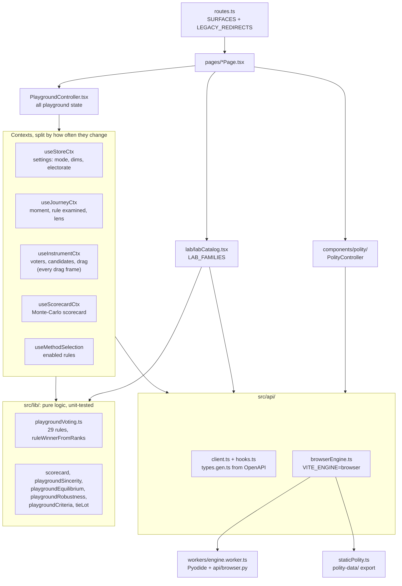
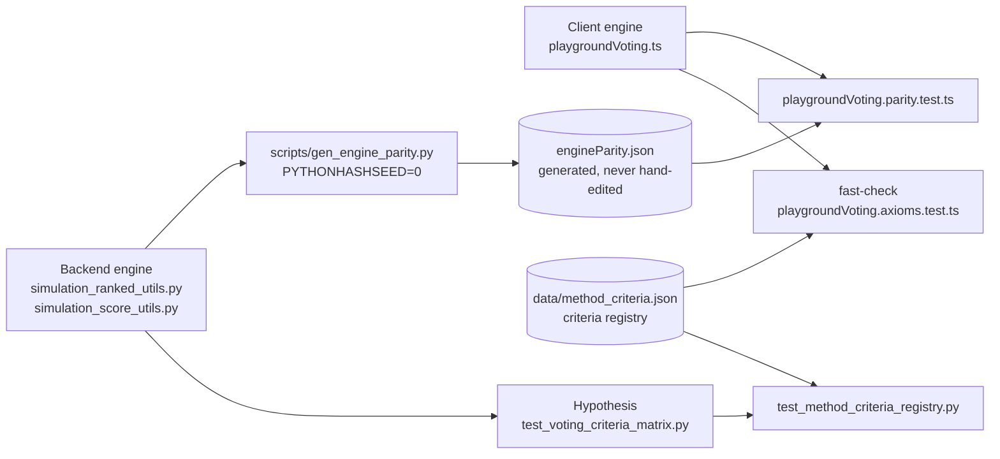
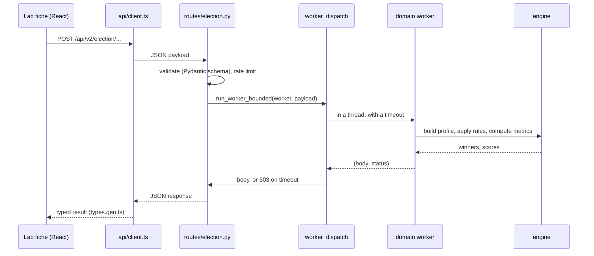
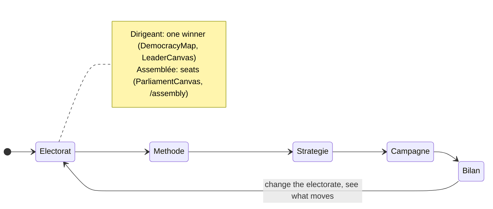

# Vote Lab: architecture and functions

> **status:** reference. Part of the [project overview](README.md); terms are defined in the
> [glossary](glossary.md). Verified against `polity` at `ce0e674` (2026-10-12).

Vote Lab teaches how voting methods behave by letting you **change the electorate and watch the
winner change**. Everything in it serves that loop: an electorate (voters as points in an
ideological space), candidates, a method, and a winner computed live.

## 1. The surfaces

`voter-app/src/routes.ts` is the single source of truth: `App.tsx` builds its routes from it, and
the e2e suite imports the same list, so a surface without a test fails CI.

| Route | Page | What the visitor does |
|---|---|---|
| `/` | `pages/HomePage.tsx` | Entry |
| `/decouvrir` | `pages/DecouvrirPage.tsx` | Discover: guided introduction |
| `/a-vous-de-jouer` | `pages/AVousDeJouerPage.tsx` | "Your turn": hands-on challenges |
| `/playground` | `pages/PlaygroundPage.tsx` | The instrument: build an electorate, pick methods, watch winners ([§3](#3-the-playground)) |
| `/laboratoire` | `pages/LaboratoirePage.tsx` | 63 fiches (deep dives), in 6 families ([§4](#4-the-laboratoire)) |
| `/polity` | `pages/PolityPage.tsx` | Explorer for Polity simulation runs (see [`polity.md`](polity.md#7-the-polity-explorer)) |

Retired pages redirect (`LEGACY_REDIRECTS`): what they did was folded into the playground (doing)
or the laboratoire (going deeper), and the account pages went with authentication
([ADR-007](../adr/ADR-007-no-authentication-stateless-anonymous-app.md)).

## 2. Architecture

### 2.1 Frontend

- **Why the contexts are split:** dragging a candidate recomputes the instrument context on every
  frame. A component that reads only settings must not re-render with it.
  `PlaygroundController.render.test.tsx` asserts that isolation. The rules are in
  [`CLAUDE.md`](../../CLAUDE.md#playground-architecture).
- **Pure libs, thin components:** each analysis (sincerity, equilibrium, robustness, criteria,
  valence) is a pure function in `src/lib/`, unit-tested, with one component that renders it.
- **Rendering:** native SVG for the always-mounted views, Recharts only in panels loaded on demand
  ([ADR-005](../adr/ADR-005-svg-native-core-recharts-for-exploration-only.md)), Canvas 2D for dense
  point clouds ([ADR-013](../adr/ADR-013-canvas-2d-for-dense-point-clouds.md)).
- **Two languages:** `src/i18n/locales/*.fr.ts` is the source of truth and the type;
  the `.en.ts` files must mirror it key for key.

### 2.2 Backend

```mermaid
flowchart LR
  subgraph routesL["api/routes/ (HTTP only)"]
    r1["election.py<br/>/api/v2/election, 39 endpoints"]
    r2["simulations.py<br/>manipulability, vote-steps, monte-carlo"]
    r3["theory.py<br/>/api/v2/theory"]
    r4["polity.py<br/>/api/v2/polity: runs, frames, citizens"]
    r5["public.py<br/>/api/v1: methods, simulate, compare"]
    r6["tech.py, health.py, metrics"]
    sock["sockets/: Socket.IO<br/>Monte-Carlo streaming"]
  end
  subgraph domainL["api/domain/ (pure workers)"]
    d1["election/workers*.py<br/>election_service.py"]
    d2["simulations/, theory/, public.py"]
    d3["polity/ explorer workers"]
  end
  subgraph engineL["api/engine/utils/ (the rules)"]
    e1["method_registry.py"]
    e2["simulation_ranked_utils.py<br/>simulation_score_utils.py"]
    e3["profile_engine.py, simulation_metrics.py,<br/>tie_lot.py, multiwinner, ..."]
  end
  dispatch["core/worker_dispatch.py<br/>semaphore + timeout"]
  routesL --> dispatch --> domainL --> engineL
```

- **Layering is enforced:** routes → domain → engine, never upward, by an import-linter contract
  in `fast_api_voter/pyproject.toml`. Conventions are in the
  [`voter-api` skill](../../.claude/skills/voter-api/SKILL.md).
- **Workers are pure:** `(payload) -> (body, status)`, no I/O. Heavy ones run off the event loop
  through `run_worker_bounded`, which caps concurrency and turns a timeout into a 503.
- **Schemas:** Pydantic models in `api/schemas/`; the OpenAPI snapshot `openapi.gen.json` is
  checked in CI and generates the frontend's `types.gen.ts`.
- **State:** none. An optional Redis cache (`engine/utils/cache.py`) memoises results.

### 2.3 The dual engine

The same rules are written twice, independently. The client needs them to answer within a drag
frame; the backend is the tested reference and serves the API. A generated fixture of golden
winners locks them together on 28 methods: 21 ordinal; score, STAR, cumulative, maximin and Nash
over a shared score matrix; approval; majority judgment. `random_ballot`, a lottery, is excluded.
Changing a rule on either side means regenerating the fixture; a mismatch is a bug until shown
otherwise, and the harness has caught real bugs on both sides
([ADR-004](../adr/ADR-004-dual-voting-engine-with-parity-lock.md)).

The same idea locks the **criteria matrix**: `method_criteria.json` states, for each method and
each of 8 criteria, a verdict and what it rests on (engine-tested, literature, variant). The
client's property tests read it directly; on the backend, `test_method_criteria_registry.py` checks
it against the satisfies/violates sets that the Hypothesis matrix (`test_voting_criteria_matrix.py`)
asserts, so either engine disagreeing fails CI
([review packet](../research/expert-review-packet.md)).

Exact ties are broken by a **seeded lot** (an FNV-1a hash), the same on both engines, never by the
order in which candidates happen to be listed
([`LISTING_ORDER_TIES.md`](../plan/vote-app/LISTING_ORDER_TIES.md)).

### 2.4 One request

In the static build, `browserEngine.ts` intercepts the same `fetch` and posts it to a Web Worker
that runs these same routers under Pyodide; the page cannot tell the difference
([EXP-023](../exploration/EXP-023-pyodide-web-worker-vs-fly-container.md)). The playground's live
winner never makes a request: it comes from the client engine.

## 3. The playground

One instrument stays on screen while a rail walks through five **moments**
([ADR-006](../adr/ADR-006-playground-single-five-moment-instrument.md)). A switch above the rail
chooses whether one leader is elected (**Dirigeant**) or an assembly (**Assemblée**).

| Moment | Component | The question it answers |
|---|---|---|
| Électorat | `ElectorateMoment.tsx`, `ElectorateComposer` | Who are the voters? Communities with a centre, spread, size and turnout |
| Méthode | `MethodMoment.tsx` | Which methods compare? (five enabled by default) |
| Stratégie | `StrategyMoment.tsx`: sincerity, equilibrium, strategic modules | Would voters do better by lying, and does the winner survive it? |
| Campagne | `CampaignMoment.tsx` | What if candidates move or opinion shifts during a campaign? |
| Bilan | `BilanMoment.tsx`: scorecard, VSE, robustness, winner explanation | How good is each method here, and why do two methods disagree? |

A winner strip shows every enabled method's winner at every step. A story (`?story=`, from
`src/lib/stories.ts`) drives the same instrument through a scripted scenario, and its claims are
checked against the engine (`storyClaims.ts`).

## 4. The laboratoire

63 fiches, each a focused experiment, arranged in 6 families (`LAB_FAMILIES` in
`components/lab/labCatalog.tsx`): **methods**, **rules** (ballot, strategy, values), **systems**
(mechanisms, systems), **dynamics** (campaign, temporal, behavioural), **theory** (theory,
analysis, results), **blank vote**. A fiche opens on one bench (the *établi*), is loaded lazily
and prefetched on hover, and can be linked to directly with `?exp=<id>`. Most fiches call a
backend endpoint; they read the same electorate as the playground.

## 5. Methods and metrics

### 5.1 The methods

29 rule ids on the client (`Rule` in `playgroundVoting.ts`); the backend's `method_registry.py`
lists 22 ranked and 9 score rules. Multiwinner rules (SPAV, Phragmén, STV, equal shares) and seat
allocations (D'Hondt, Sainte-Laguë, largest remainder) live apart, in
`simulation_multiwinner_utils.py`. Each method is described in
[`THEORY.md`](../../THEORY.md) §2 and listed in the [glossary](glossary.md#methods). An unknown
name raises `UnknownMethod`; nothing silently falls back to plurality.

### 5.2 The spatial model

A voter is a point in 1 to 3 ideological dimensions; a candidate too. A voter's utility for a
candidate is **−distance + valence** (valence: quality apart from ideas, 0 by default). From
utilities come rankings (ordinal ballots), scores, grades and approvals. The electorate is a
mixture of communities (`playgroundElectorate.ts`). Turnout can be full, or lowered by alienation
or indifference. THEORY.md §1.2 gives the model; the backend's `profile_engine.py` also generates
non-spatial profiles (impartial culture, Mallows, Pólya urn, Plackett-Luce and others) for the
fiches that need them.

### 5.3 The metrics

| Metric | Definition | Code |
|---|---|---|
| **VSE** (voter satisfaction efficiency) | (E[u(winner)] − E[u(random candidate)]) / (E[u(best)] − E[u(random candidate)]): 1 = always the utilitarian best, 0 = no better than chance | `lib/playgroundBehavior.ts` (`vseOfWinner`), `VseModule.tsx`, backend `election_service.py` |
| **Condorcet efficiency** | Share of re-rolled electorates with a Condorcet winner in which the method elects them | `lib/scorecard.ts` |
| **Strategic resistance** | Share of re-rolls where the winner survives a compression probe (each voter puts their preferred frontrunner top and the other bottom). A stated heuristic, not a full Gibbard–Satterthwaite analysis | `lib/scorecard.ts` |
| **Welfare** | 1 − normalised Bayesian regret of the winner | `lib/scorecard.ts`, `simulation_metrics.py` |
| **Majority satisfaction** | Share of voters for whom the winner is at least as good as their median candidate | `lib/scorecard.ts` |
| **Simplicity** | A stated convention per rule (ballot and tally complexity), constant | `lib/scorecard.ts` |
| **Stability** | Share of re-rolls electing the modal winner | `lib/scorecard.ts` |
| **Proportionality** (assembly) | 1 − normalised Gallagher index | `workers_playground.py` (labels: `lib/playgroundMeta.ts`) |
| **Pluralism** (assembly) | Share of the effective number of parties in votes that survives into seats | `workers_playground.py` (labels: `lib/playgroundMeta.ts`) |
| **Effective votes, minority representation, governability, gerrymander resistance** (assembly) | 1 − wasted votes; parties ≥ 3% holding a seat; 1 / size of the smallest majority coalition; seat stability when district lines move | `workers_playground.py` (labels: `lib/playgroundMeta.ts`) |
| **Sincerity** | For each bloc: is its sincere ballot its best response, or would compromising or burying do better? | `lib/playgroundSincerity.ts` |
| **Equilibrium** | Iterated better-response: does the sincere winner survive strategic play? | `lib/playgroundEquilibrium.ts` |
| **Robustness** | How often the same winner comes back over re-drawn seeds of the same electorate | `lib/playgroundRobustness.ts` |

The assembly axes are computed by the backend (`/api/v2/election/assembly-scorecard`), the
leader axes in the browser. Every leader-mode number is computed over Monte-Carlo re-rolls of the electorate (fresh seeds,
same assumptions), so each carries a band. The **values lens** first removes the methods that are
strictly Pareto-dominated, which is an objective claim, and then lets the visitor's weights pick
out a point on what remains. It never ranks the methods into a leaderboard (`scorecard.ts` header).

## 6. How it is kept correct

| Gate | What it catches | Where |
|---|---|---|
| Parity test | The two engines disagreeing on a winner | `playgroundVoting.parity.test.ts` |
| Axiom property tests | A method's behaviour contradicting the criteria registry | fast-check + Hypothesis, see §2.3 |
| Z3 proofs (partial) | Condorcet consistency of Minimax and Schulze for all small electorates | [EXP-002](../exploration/EXP-002-z3-formal-voting-proofs.md) |
| Story claims | A story saying something the engine does not do | `storyClaims.ts`, e2e winner oracle |
| e2e on Chromium, Firefox, WebKit and mobile | A surface broken in a real browser; anchored on `data-testid` | `voter-app/tests/e2e/`, `.github/workflows/e2e.yml` |
| Mutation testing | Tests that pass whatever the engine does | Stryker (frontend), mutmut (backend), [EXP-015](../exploration/EXP-015-mutmut-mutation-testing-scope.md) |
| Fuzzing | Crashes on odd inputs | atheris, [EXP-011](../exploration/EXP-011-atheris-coverage-fuzzing.md) |
| Quality ratchets | Coverage or lint counts getting worse | `.github/quality-baseline.json`, [`voter-ci` skill](../../.claude/skills/voter-ci/SKILL.md) |
